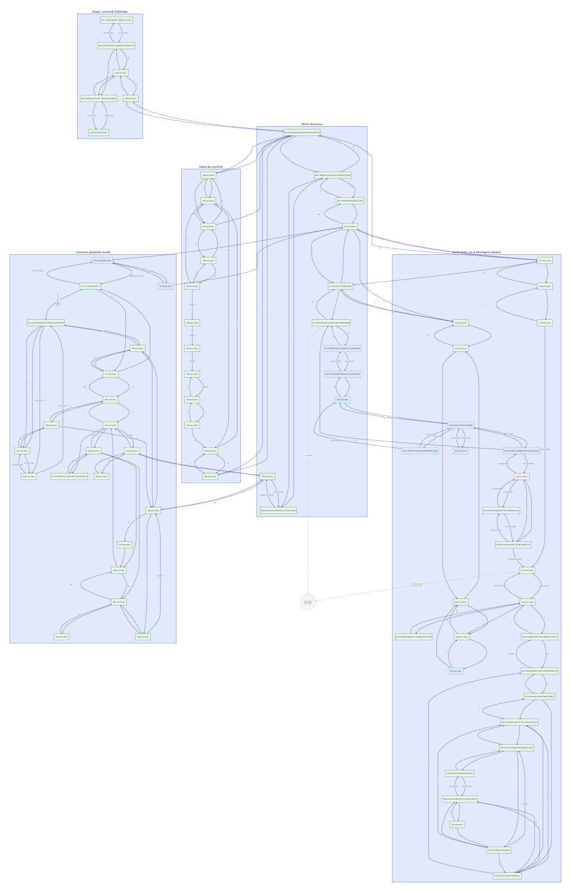

# Carte du jeu — graphe exhaustif des lieux (The Hobbit, Oric)

Source : `scripts/map_static.py` sur `data/hobbit.bin` (recoupement
terrain OK : 6/6 mouvements observés F1–F5 présents dans le graphe).
**78 records, 203 sorties.** Détail d'élucidation : `docs/block4-analysis.md`
(§ records, § exits `$26DA`), plan d'octets : `docs/memory-map.md`.

Carte générée (`docs/map.svg` ← `docs/map.d2`) par `scripts/map_draw.py` :
**5 sous-graphes** (Ouest/Trollshaws, Monts Brumeux, Cavernes gobelines,
Forêt noire–Lac–Montagne, Hauts du nord-est), nœuds colorés *visité* /
*patch-only* / *zone sombre*, arêtes = direction + `cond $YY`, cible `$00`
en pointillé vers le nœud *vide/mort*.

## Format

Chaque record (`$2070`, id `<$50`) porte après sa description une liste
`(direction, cond, dest)*` terminée par `$FF` :
`D→$XX` = sortie vers le record `$XX` ; `[cond $YY]` = exige l'état `$YY`
(clé `$1A62`, évaluée via `L5331+8` dans `cond_eval`, voie `direct=0`) ;
sans cond = passage libre. Directions : N/S/E/W/NE/NW/SE/SW/UP/DOWN
(mots `$26DA`, vérifiés au `word_render`).

`[visitée]` = vue sous harnais (texte + occupants constatés).

**Visitées : 78/78 records valides (2026-10-10)** — 79 slots `$01`–`$4F`
dont `$2F` nul. Graphe parcouru (`solver.py --route ... --record`) : tous les
records ont un `ploc` observé dans `solver.db`, **sauf `$42`** (voir ci-dessous).
Les **10 lieux conditionnels** (`08 14 15 1A 1B 1C 1D 32 42 43`, gated
`$07/$09/$0A`) n'ont été atteints/rendus que par **patch debug** de
`player.eloc` (`$1B2A`, offset 44 du blob) + LOOK — jamais en jeu normal.
`$42` : texte rendu (nœud `PATCH:42`) mais l'event *wood elf* capture le joueur
→ `ploc` forcé à `$1F`, et le SAVE du harnais reste incomplet (`snap-incomplet`)
donc non rejouable. Zones sombres (mouvements à destinations variables) :
`$1E $1F $20` (+ `$16` ?, cf. anomalie NW).
Les noms entre guillemets = noms courts reformulés (cf. `map_static.NAMES`) ;
les descs brutes du moteur (phrases, parfois tronquées) ne sont plus affichées.

## Chaîne principale (ouest → est)

- `$01` [visitée] "Tunnel hall" (départ, coffre, porte verte) :
  E→$04 [cond $05].
- `$04` [visitée] "Dreary hills" (Gandalf/Thorin) :
  W→$01 [cond $05], E→$05, N→$05 (×2, doublon binaire), NE→$06.
- `$05` [visitée] "Trolls' clearing" (hideous+vicious, MORTEL) :
  SW→$04, SE→$09, N→$06.
- `$06` [visitée] "Trolls' path" (safe, rock door au nord) :
  S→$05, N→$07 [cond $01] (la porte rock).
- `$07` "Trolls' cave" : S→$06 [cond $01].
- `$09` [visitée] "Rivendell" (Elrond + lunch clé `$26`) :
  E→$0A, W→$05.
- `$0A` [visitée] "Misty mountains" (warg offensif) :
  E→$0B, N→$44, W→$09, S→$49.
- `$0B` "High pass" :
  E→$0C, W→$0A, N→$0E.
- `$0C` "Mountain path" : E→$16, W→$0B.
- `$0E` "Dry cave" :
  DOWN→$0F [cond $06], S→$0B.
- `$0F` "Dark passage" : UP→$0E [cond $06], S→$34, NE→$3A.
- `$16` "Beorn's house" : NE→$18, NW→$14, S→$2E, SW→$0C, N→$31.
- `$18` "Mirkwood gate" : W→$16, S→$2E, E→$19.
- `$19` "Bewitched forest" :
  W→$18, E→$42 (rive ouest), S→$00 [cond $09] (le `$00` = vide/mort ?).
- `$42` "West bank" : W→$19, E→$43 [cond $09].
- `$43` "East bank" : E→$32, W→$42 [cond $09].
- `$32` "Green forest" : NE→$1A [cond $07], W→$43.
- `$1A` "Spider place" : E→$1D [cond $07], W→$32 [cond $07],
  N→$1C [cond $07], S→$1B [cond $07].
- `$1B` "Tangled forest" : N→$1A [cond $07], W→$32 [cond $07].
- `$1D` "Deep bog" : W→$1A [cond $07].
- `$1C` "Elvish clearing" :
  W→$19, E→$1A [cond $07], NE→$1E [cond $0D].
- `$1E` "Elvenking's halls" : E→$1F [cond $08], S→$20, W→$1C [cond $0D].
- `$1F` "Elven dungeon" :
  SW→$20 [cond $08], W→$1E [cond $08].
- `$20` "Wine cellar" :
  NE→$1F [cond $08], N→$1E, DOWN→$21 [cond $0C].
- `$21` "Barrel" : E→$22 [cond $27], UP→$00 [cond $0C], S→$00 [cond $2A].
- `$22` "Long lake" : N→$24, E→$23, NW→$21 [cond $27], S→$2D.
- `$2D` "Waterfall" : S→$08, W→$03.
- `$08` "Running river" : N→$2D, W→$03.
- `$03` "Forest" : W→$02, E→$2D.
- `$02` "Forest road" : E→$03, W→$2E.
- `$2E` "Forest road" : E→$02, N→$18.
- `$23` "Wooden town" : N/S/E/W→$22 (cul-de-sac).
- `$24` "Strong river" : UP→$25, S→$22.
- `$25` "Barren land" : N→$26, DOWN→$24.
- `$26` "Dale ruins" : N→$27, S→$25, NW→$28.
- `$27` "Mountain gate" : N→$29, S→$26, W→$28.
- `$29` "Dragon halls" : S→$27, E→$2B, UP→$2C.
- `$2B` "Straight passage" : W→$2A [cond $0B], E→$29.
- `$2A` "Steep bay" : S→$28, E→$2B [cond $0B], N→$33.
- `$33` "Empty place" : S→$2A, UP→$2C.
- `$2C` "Lonely mountain" : DOWN→$29, W→$2A, S→$27, SW→$28.
- `$28` "Ravenhill" : N→$2A, SE→$25, E→$27.
- `$30` "Mountains" : SW→$31, SE→$17.
- `$31` "Great river" : NE→$30, S→$16, E→$18, SW→$0A.
- `$17` "Forestriver" : SE→$21 [cond $2A], N→$30.

## Gobelins et cavernes (nord)

- `$10` "Torch cavern" : DOWN→$39, NE→$12, SE→$0D [cond $11].
- `$13` "Goblin gate" (piège : 9 sorties sur 10 renvoient en `$10`) :
  W/N/S/E/SE/SW/DOWN/NW→$10, UP→$14 [cond $0A], NE→$41.
- `$14` "Goblin gate" : DOWN→$13 [cond $0A], E→$15.
- `$15` "Treeless opening" : E→$16, W→$14.
- `$0D` "Goblins' dungeon" : N→$10 [cond $11], W→$12 [cond $1B].
- `$12` "Winding passage" : SW→$10, SE→$3F, N→$0D [cond $1B].
- `$3F` "Dark passage" : UP→$40, N→$12, E→$3A.
- `$40` "Dark passage" : NW→$41, W→$36, SW→$3F.
- `$41` "Dark passage" : N→$40, SE→$39, E→$13.
- `$39` "Dark passage" : UP→$10, W→$41, N→$3A.
- `$3A` "Dark passage" : SE→$3E, E→$0F, S→$39, UP→$3B.
- `$3B` "Dark passage" : DOWN→$3A, S→$3C.
- `$3C` "Dark passage" : SE→$3D, N→$3B, NW→$38.
- `$3D` "Dark passage" : N→$36, NW→$3C.
- `$38` "Dark passage" : SW→$3C.
- `$3E` "Dark passage" : E→$3D.
- `$34` "Dark passage" : N→$0F, DOWN→$35, UP→$36.
- `$35` "Dark passage" : UP→$34.
- `$36` "Dark passage" : DOWN→$34, SE→$37, S→$40, SW→$11.
- `$37` "Dark passage" : S→$11, NE→$36, SW→$3D, W→$3C.
- `$11` "Underground lake" : N→$37.

## Hauts (nord-est, `$44`–`$4F`)

- `$44` "Narrow path" : E→$47, NE→$45, S→$0A.
- `$45` "Narrow path" : N→$46, SW→$44, S→$0A.
- `$46` "Narrow path" : SE→$48, S→$45.
- `$47` "Narrow path" : NW→$45, S→$4A, W→$44.
- `$48` "Narrow path" : NW→$46, SW→$47, DOWN→$4B.
- `$49` "Narrow path" : E→$4A, N→$0A.
- `$4A` "Narrow path" : N→$47, W→$49.
- `$4B` →DOWN→ `$4C` →DOWN→ `$4D` →DOWN→ `$4E` (chaîne verticale : steep path ×3 puis deep misty valley).
- `$4E` "Misty valley" : E→$4F, UP→$4D.
- `$4F` "Misty valley" : W→$4E, UP→$4A.

## Conditions (états `$1A62` — identités : `memory-map.md` §2)

`$00` = libre (quasi toutes les sorties). Non-nulles : `$01` (porte rock
`$06`N/`$07`S), `$05` (porte verte `$01`E/`$04`W), `$06` (`$0E`/`$0F`),
`$07` (araignées `$1A`/`$1B`/`$1C`/`$1D`/`$32`), `$08` (palais elfe
`$1E`/`$1F`/`$20`), `$09` (rivière `$19`S/`$42`/`$43`), `$0A` (gate gobelin
`$13`/`$14`), `$0B` (passage `$2A`/`$2B`), `$0C` (barriques `$20`/`$21`),
`$0D` (`$1C`/`$1E`), `$11` (`$0D`/`$10`), `$1B` (`$0D`/`$12`), `$27`
(`$21`/`$22`), `$2A` (`$17`/`$21`). Sens fin (quel bit/champ de l'état
fait foi) : ouvert — à lever en jeu.

## Points d'attention jeu

- **Anomalie `RUN`** : `$05` n'a PAS de sortie SUD (SW/SE/N) mais
  `RUN SOUTH` → `$09` fonctionne. Le verbe `RUN` emprunte un autre chemin
  (`$6FAC`/`L7014` ?) — à élucider, et tester `RUN <dir>` ailleurs.
  (Note : `SE` `$05`→`$09` libre marche aussi — `RUN` inutile ici.)
- **Anomalie `$16` NW** (F45c) : obtenu `$31` (dest de NORTH), attendu
  `$14` — zone sombre à random ? À trancher (retest + OCR).
- **Fenêtre `$06`** (F45d/e) : `DOWN $0E` + `$A0` → **`$0D`**, pas `$0F`.
  Route alternative libre : `$3A` E→`$0F` (à tester depuis `$39`/`$41`).
- **Dests `$00`** (`$19`S, `$21`UP/S) : le record nul = chute dans le vide ?
  (mort probable — tester avec SAVE avant).
- **Dests `$00`** (`$19`S, `$21`UP/S) : le record nul = chute dans le vide ?
  (mort probable — tester avec SAVE avant).
- **Piège `$13`** : la gate gobeline renvoie en `$10` sauf UP conditionnel.
- **Cul-de-sac `$23`** : tout ramène en `$22`.
- **Doublon `$04`** : NORTH→`$05` en double (inoffensif).
- **Lieux** : **tous visités (78/78 records valides)** au 2026-10-10 — voir
  entête. Les conditions `$07` (araignées)/`$09` (rivière)/`$0A` (gate
  gobeline) n'ont pas été levées en jeu ; accès debug via `player.eloc`.
